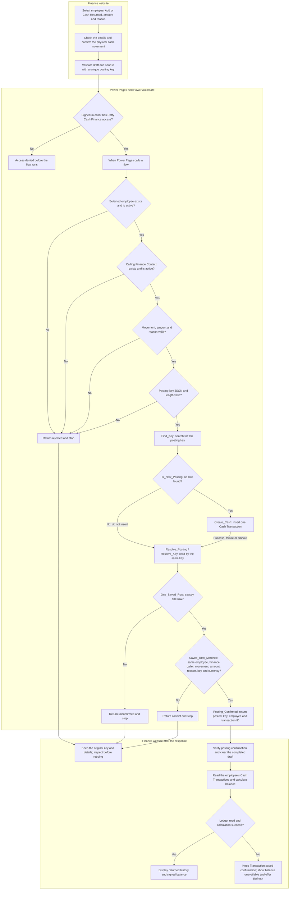

# Finance cash movement: current flow

Updated 2026-10-30. This documents the simpler Finance flow built in this
conversation, including the frontend work before and after the flow. It is
not the superseded recipe that calculated the entire ledger inside Power
Automate. Action names reflect the guided build; no exported tenant definition
has been independently inspected.

## Flowchart



## What each part does

| Part | Actual actions / behavior | Purpose |
| --- | --- | --- |
| Caller identity | Trigger User ID into `vActorId`; `Get_Actor`, `Actor_Is_Active` | Use the signed-in operator, rather than a caller ID supplied by the browser. |
| Employee eligibility | `Get_Employee`, `Employee_Is_Active` | Target an existing active employee. |
| Submitted values | `Input_Movement`, `Input_Amount`, `Input_Notes`, `Basic_Input_Is_Valid`, `Amount_Scaled_Text`, `Amount_Cents`, `Valid_Amount`, `Notes`, `Movement_Type` | Permit only cash given/returned, positive amounts with exact cents and a valid reason. The cents helpers validate the submitted amount, not the whole ledger. |
| Posting key | `Input_Key`, `Posting_Key`, `Parse_Posting_Key`, `Employee_Id` | Normalize the operation key, validate its JSON/type/length and use the native employee GUID. The parser does not enforce full UUID syntax. |
| Initial lookup | `Find_Key`, `Is_New_Posting` | Attempt one create only when no existing key is found. |
| Cash write | `Create_Cash` | Save positive `hr_amount`, type, employee, reason, key, recorded Finance Contact and PKR currency. Linked Request is empty for Finance movements. |
| Recovery | `Resolve_Posting`, `Resolve_Key`, `One_Saved_Row`, `Saved_Row` | Resolve the same durable row after a normal create, duplicate-key collision or uncertain create result. Zero/multiple rows are not confirmation. |
| Event comparison | `Saved_Row_Matches` | Require the saved key, employee, operator, type, exact cents, unchanged reason, configured currency, empty Linked Request and nonempty transaction ID to match. Never overwrite an existing row on retry. |
| Success response | `Posting_Confirmed` | Return `posted` and the saved transaction identity. The legacy Number `balance` output is only a schema-compatible zero placeholder, ignored by the current website. |
| Website update | `postMovement`, `cashTransactions`, `sumTransactions`, Finance `loadLedger` | Verify the response, then calculate the displayed balance from accessible saved ledger rows. |

`Resolve_Posting` is configured to run after `Is_New_Posting` succeeds, fails or
times out, but not when skipped. Earlier validation must not be bypassed. This
is the recovery path for an uncertain create, not a blanket handler that makes
every failed action successful. An unexpected query/transport/expression failure
without a valid posting response leaves the website's operation unconfirmed.

The existing Active `crec6_postingkey` unique key prevents two rows for the same
operation. Retrying must keep both the original key and the original event.
A different key is a different operation and can create another transaction.
The current pending draft/key live in the browser page; do not reload while
the outcome is uncertain. No automatic cash retry is performed.

## Where the balance comes from

```text
Signed balance = Cash Given - Approved Expenses - Cash Returned
```

| Cash Transaction type | Stored amount | Effect on displayed balance |
| --- | --- | --- |
| Advance Given (`123140000`) | Positive PKR amount | Add |
| Expense Approved (`123140001`) | Positive PKR amount | Subtract; created by the separate approval backend |
| Cash Returned (`123140002`) | Positive PKR amount | Subtract |

The table is `hr_cashtransaction`, entity set `hr_cashtransactions`. The Finance
flow does not update `Contact.hr_currentbalance`. There is no additional
balance-update action after insertion. Negative balance is allowed: the company
owes the employee. Positive balance means the employee holds company cash.

The website refresh reads what Power Pages returns. Portal/page caching can
delay visibility after a flow writes to Dataverse; it is not a transactionally
locked balance. User reports the three-row history and expected +100 display
correct after a hard refresh. The exact earlier cache layer was not isolated.
Refreshing a balance must not post another cash movement.

## Completion and handoff

The core Finance page and simpler cash-movement flow are implemented, and the
user reports working posting and correct history/balance. This is sufficient
to begin the manager approval module; it is not final production sign-off.

| Item | Status |
| --- | --- |
| Employee selection, balance/history, Add and Cash Returned UI | Implemented locally; user reports Finance working. |
| Native Finance flow invocation, validation, create/read-back and response | Guided build completed by user; posting now reported working. Full exported definition not independently audited. |
| Website computes signed ledger balance separately | Implemented; correct display user-confirmed after hard refresh. |
| Required AJAX header and lowercase response names | Fixed locally; user reports the flow now runs. Keep the permanent shared template current. |
| Ledger query no longer limited to first 100 rows | Fixed and tested locally; publication of this latest correction not separately confirmed. |
| Prevent operator posting to their own account | Proposed, not implemented. User asked about self-increases; recommendation to block both directions still needs a clear policy choice. |
| Cash Returned, same-key replay and non-Finance denial | Covered in local mocked tests; explicitly verify in the tenant before normal use. Concurrency/uncertain-result scenarios also need live verification. |
| Manager approval and automatic Expense Approved ledger row | Next module; not implemented by this Finance flow. |

Local baseline: 131 unit tests and 11 mocked Finance browser scenarios passed.
This chart/documentation update changes no code, permissions, flow or data.

The manager approval flow should consume complete expense requests, route them
to the assigned manager, record the decision, and write one linked Expense
Approved transaction on approval. It should use the same ledger/sign convention
and prevent duplicate expense posting. Pending/rejected requests must not alter
the balance. The detailed approval design/build is separate work.

## Related files and references

- [Finance setup](FINANCE_SETUP.md)
- [Manual flow build and history](FINANCE_FLOW_SETUP.md)
- [Canonical website helper](pettycash-modules.js)
- [Implementation log](IMPLEMENTATION_LOG.md)
- [Microsoft: native Power Pages flow invocation and roles](https://learn.microsoft.com/en-us/power-pages/configure/cloud-flow-integration)
- [Microsoft: Run after and error handling](https://learn.microsoft.com/en-us/power-automate/guidance/coding-guidelines/error-handling)
